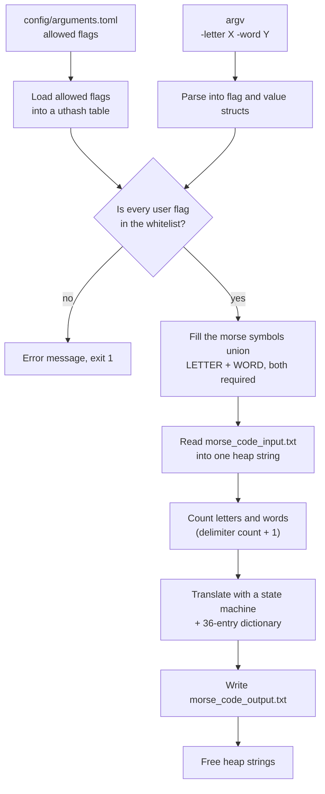

# (Over-Engineered) Morse Code Translator

> A command-line Morse code decoder written in C, with user-defined delimiters, a config-driven flag whitelist, a hash table, and a hand-rolled dictionary.
> Deliberately over-engineered, as an exercise in structuring a C project, managing heap memory, and defensive argument handling.


-brightgreen)

---

## Table of Contents
1. [Overview](#1-overview)
2. [Quick Start](#2-quick-start)
    - 2.1. [Build](#21-build)
    - 2.2. [Run](#22-run)
    - 2.3. [Input file format](#23-input-file-format)
    - 2.4. [Argument errors](#24-argument-errors)
3. [How It Works](#3-how-it-works)
4. [Project Structure](#4-project-structure)
5. [Implementation Details](#5-implementation-details)
    - 5.1. [Config-driven flag whitelist](#51-config-driven-flag-whitelist)
    - 5.2. [Argument parsing](#52-argument-parsing)
    - 5.3. [Required symbols as a union](#53-required-symbols-as-a-union)
    - 5.4. [Reading the input file](#54-reading-the-input-file)
    - 5.5. [Translating](#55-translating)
    - 5.6. [Memory ownership](#56-memory-ownership)
6. [Design Decisions and Trade-offs](#6-design-decisions-and-trade-offs)
7. [Customisation](#7-customisation)
8. [Limitations](#8-limitations)
9. [References](#9-references)

---

## 1. Overview

The program reads Morse code from a text file and writes the English translation to another text file. Instead of hard-coding how letters and words are separated, **you tell it which symbols to use** as command line arguments.

```bash
./bin/morse -letter "'" -word "/"
```

| | |
|---|---|
| **Input** | `morse_code_input/morse_code_input.txt` |
| **Output** | `morse_code_output/morse_code_output.txt` |
| **Supports** | `A-Z` and `0-9` (36 symbols) |
| **Delimiters** | Chosen by you with `-letter` and `-word` |

**Example.** With `'` between letters and `/` between words:

| Input file | Output file |
|---|---|
| `-'....'.'/--.-'..-'..'-.-.'-.-'/-...'.-.'---'.--'-.'/...` | `THE QUICK BROWN FOX JUMPED OVER THE LAZY DOG 1234567890` |

---

## 2. Quick Start

### 2.1. Build
Only a C compiler is needed. The hash table library (uthash) is vendored in `lib/`.

```bash
mkdir -p bin
gcc -o bin/morse main.c utils/*/*.c
```

### 2.2. Run
Run it from the **project root**, because the config and input/output paths are relative.

```bash
./bin/morse -letter "'" -word "/"
```

| Flag | Example value | Meaning |
|---|---|---|
| `-letter` | `'` | The symbol that ends each letter |
| `-word` | `/` | The symbol that separates words |

- Both flags are **required**. Their order doesn't matter.
- Quote the value in your shell, especially for characters like `'` or `/`.
- Which flags are allowed is defined in [`config/arguments.toml`](config/arguments.toml), not in the C code.

By default the top-level debug mode is on, so you will also see `<main>` progress messages:

```text
<main> there are 46 letters here, based on the ' delimiter.
<main> there are 10 words here, based on the / delimiter.
<main> translated string is "THE QUICK BROWN FOX JUMPED OVER THE LAZY DOG 1234567890"
<main> translated string written to file "morse_code_output/morse_code_output.txt"
```

### 2.3. Input file format

The input is one single line made of only these characters: `.`, `-`, your letter delimiter, and your word delimiter.

| Rule | Detail |
|---|---|
| Every letter ends with the letter delimiter | This includes the last letter of each word, so a word break looks like `'/` |
| The very last letter has **no** delimiter | The end of the file ends it |
| No spaces or line breaks | Including a trailing newline at the end of the file |
| Don't start the file with a delimiter | This gives an empty letter |

Reading the start of the sample, `-'....'.'/--.-'` decodes like this:

| Part | Meaning |
|---|---|
| `-` then `'` | `T` |
| `....` then `'` | `H` |
| `.` then `'` | `E` |
| `/` | word break (a space in the output) |
| `--.-` then `'` | `Q` |

### 2.4. Argument errors
Bad arguments stop the program early with a message and exit code `1`.

| Situation | Message (summary) |
|---|---|
| `-word` missing | `missing one or more required arguments!` |
| Flag not in the config | `invalid flag "-bogus" found in arguments` |
| Flag without a value | `missing arguments before/after argument "-word"` |
| Flag without a leading `-` | `invalid flag syntax in "letter"` |

---

## 3. How It Works



`main()` is intentionally thin: it only calls one function per step and checks the result, following the structure recommended in *How to Write a Good C Main Function*. All the real work lives in small modules under `utils/`.

---

## 4. Project Structure

```text
.
├── main.c                          # orchestrator: one call per step
├── config/arguments.toml           # allowed flags
├── morse_code_input/               # input text file
├── morse_code_output/              # output text file
├── defines/
│   ├── english_morse_dict.h        # the 36 Morse patterns as #defines
│   ├── program_operation_def.h     # paths, buffer sizes, constants
│   └── debugging_def.h             # debug switches
├── structs/structs_definitions.h   # shared structs
├── unions/unions_definitions.h     # morse symbols union
├── lib/
│   ├── hash_map_lib/               # uthash (third-party, vendored)
│   └── dict_lib/dict_fixed_size.h  # fixed-size string dictionary (macros)
└── utils/                          # one folder per concern, each with .h and .c
```

| Module (`utils/`) | Responsibility | Key functions |
|---|---|---|
| `arg_get_allowed_flags_fns` | Read the allowed flags from the TOML file | `get_flags_from_config_file_by_pointer` |
| `hash_utils` | Put strings into / free a uthash table | `add_string_array_into_hash`, `free_hashable_string_in_hash` |
| `arg_parse_input_fns` | Turn `argv` into flag/value pairs | `parse_user_arguments` |
| `arg_check_input_is_valid_fns` | Check each user flag against the whitelist | `check_user_flags_to_allowed_flags` |
| `get_morse_symbols_from_args` | Store the `-letter` and `-word` values | `get_morse_symbols_from_args` |
| `get_morse_code_input_fns` | Load the input file into a heap string | `file_into_malloc_str` |
| `file_utils` | File opening, counting, reading, writing | `open_file_and_return_file_stream`, `file_to_string`, `write_string_to_file` |
| `str_utils` | Substring counting, freeing strings | `count_substrings`, `free_malloced_str` |
| `eng_to_morse_dict_fns` | Build the 36-entry dictionary | `init_str_dict_fs_morse_to_eng` |
| `translate_morse_to_char_fns` | Decode Morse into English | `translate_morse_to_english` |

Every header documents its functions with the same block: **parameters**, **action**, and **returns**.

---

## 5. Implementation Details

### 5.1. Config-driven flag whitelist
The allowed flags are not in the C code. They are read from [`config/arguments.toml`](config/arguments.toml):

```toml
[flags]
allowed_flags = ["-letter", "-word"]
```

`get_flags_from_config_file_by_pointer` is a small hand-written parser. It works in separate steps so that each stays linear in the line length:

1. **Find the line** that starts with the key `allowed_flags`.
2. **Count the double quotes.** An odd count means a quote is unmatched, so it prints a helpful error and stops.
3. **Record each quote pair** as a start pointer and an end pointer (`struct enclosing_char_start_end`).
4. **Copy the text between each pair** into an array of strings, which is the flag list.

The flags are then added to a **uthash** table (`hashable_string_struct` holding a `UT_hash_handle`) using `HASH_ADD_KEYPTR`. Each user-supplied flag is checked with `HASH_FIND_STR`, so validation is a hash lookup rather than a loop over strings.

### 5.2. Argument parsing
`parse_user_arguments` walks `argv` two entries at a time and fills an array of `flag_and_value` structs:

```c
typedef struct flag_and_value {
    size_t flag_argno;   // which argument number the flag is
    char*  flag;         // an argument which starts with '-'
    size_t value_argno;  // which argument number the value is
    char*  value;        // the argument that follows the flag
} flag_and_value;
```

- The array is sized `(argc - 1) / 2` and lives on the **stack**, so there is nothing to free.
- The structs hold **pointers into `argv`**, so no strings are copied.
- For each pair it checks that a value exists, that the flag starts with `-`, and that something follows the `-`.

### 5.3. Required symbols as a union
After validation, the `-letter` and `-word` values are stored in a union. The union overlays a struct (named fields for readable code) with a 2D array (so a loop can check every required member):

```c
typedef union morse_symbols_union {
    struct morse_symbols_struct {
        char LETTER[MAX_CHAR_PER_LINE];
        char WORD[MAX_CHAR_PER_LINE];
    } morse_symbols_struct;

    char morse_symbols_members_arr[REQUIRED_FLAGS_COUNT][MAX_CHAR_PER_LINE];
} morse_symbols_union;
```

The translator uses `morse_symbols_struct.LETTER`, while the "were all required flags provided?" check loops over `morse_symbols_members_arr`.

### 5.4. Reading the input file
`file_into_malloc_str` reads the file in two passes:

1. **Count** the characters in the file.
2. `malloc` exactly that many bytes plus one for the null terminator, `rewind` the stream, and **copy** the characters in.

The result is returned as a `malloc_str` struct that carries both the pointer and the length:

```c
typedef struct malloc_str {
    char*  str_ptr;  // the heap string
    size_t str_len;  // its length
} malloc_str;
```

Before translating, `count_substrings` counts the delimiters (without overlapping matches), giving `letters = letter delimiters + 1` and `words = word delimiters + 1`. The `+ 1` is there because the last letter and the last word have no delimiter after them.

### 5.5. Translating
Because the counts are known, the output buffer is allocated at its **exact size**: `(words - 1) + letters` characters, plus one for the terminator. That is one character per letter and one space between each pair of words.

`translate_morse_to_english` then walks the input one character at a time with a small buffer:

```c
for (size_t i = 0; i < morse_str->str_len; i++) {
    current_char = morse_str->str_ptr[i];
    if (current_char == LETTER[0] || i + 1 == len) {  // end of a letter (or end of input)
        // terminate the buffer, look it up in the dictionary,
        // append the English character, flush the buffer
    } else if (current_char == WORD[0]) {             // end of a word
        // append ' '
    } else if (current_char == DOT_CHAR || current_char == DASH_CHAR) {
        ch_buffer[morse_ch_buffer_index++] = current_char;  // build up the Morse letter
    } else {
        // unexpected character: print an error and stop
    }
}
```

| Character seen | Action |
|---|---|
| `.` or `-` | Append to the buffer |
| Letter delimiter | Look up the buffer in the dictionary, append the result, clear the buffer |
| Word delimiter | Append a space |
| Last character of the input | Add it to the buffer, then treat it as the end of a letter |
| Anything else | Error |

**The dictionary** (`lib/dict_lib/dict_fixed_size.h`) is a fixed-size string-to-string map built from two parallel `char**` arrays, with `max_length` and `next_free_index` bookkeeping. It is implemented as macros (`new_fs_str_dict`, `add_entry_fs_str_dict`, `get_value_fs_str_dict`, `free_fs_str_dict`, `is_full_fs_str_dict`). It is filled from `defines/english_morse_dict.h`:

```c
#define A_morse ".-"
#define B_morse "-..."
#define morse_0 "-----"
```

That gives 26 letters + 10 digits = `MORSE_CHAR_COUNT` (36) entries. Lookup is a `strcmp` scan over those 36 keys, which is fast enough for a table that never changes.

### 5.6. Memory ownership
Heap memory is used only where the size isn't known at compile time, and each allocation has a clear owner:

| Allocation | Allocated by | Freed by |
|---|---|---|
| Hash table items | `add_string_array_into_hash` | `free_hashable_string_in_hash` (in `main`) |
| Input file string | `file_into_malloc_str` | `free_malloced_str` (in `main`) |
| Translated string | `translate_morse_to_english` | `free_malloced_str` (in `main`) |
| Dictionary | `init_str_dict_fs_morse_to_eng` | `free_fs_str_dict` (at the end of translation) |

`free_malloced_str` returns `NULL`, and callers assign it back to their pointer (`ptr = free_malloced_str(ptr);`) so no dangling pointer is left behind.

---

## 6. Design Decisions and Trade-offs

| Decision | Reason | Trade-off |
|---|---|---|
| **Allowed flags in a config file** | Add or remove a flag without touching the C code | Needs a hand-written parser that expects the list on one line |
| **uthash for the whitelist** | O(1) flag lookup with a proven, header-only library | Overkill for two flags (hence "over-engineered") |
| **Stack arrays and VLAs where possible** | Follows *NASA Power of 10*, Rule 3 (avoid dynamic allocation) and avoids leaks | Fixed maximum sizes (256), and stack usage grows with the input |
| **Heap only for file contents** | The input size isn't known in advance | Has to be freed explicitly |
| **Count delimiters first** | The output buffer can be allocated at its exact size | Relies on the delimiters being used correctly |
| **Fixed-size dictionary as macros** | No hashing needed for 36 fixed entries, and no external dependency | Macros have no type checking |
| **Thin `main()` and one module per concern** | Each step is readable and testable on its own | Many small files for a small program |
| **Constants in `program_operation_def.h`** | All tunable limits and paths in one place | Compile-time only |

---

## 7. Customisation

**Compile-time settings** in [`defines/program_operation_def.h`](defines/program_operation_def.h):

| Constant | Default | Purpose |
|---|---|---|
| `CONFIG_ARGUMENTS_PATH` | `config/arguments.toml` | Allowed-flags file |
| `KEY_LOOKING_FOR` | `allowed_flags` | Which TOML key to read |
| `MORSE_CODE_INPUT_PATH` | `morse_code_input/morse_code_input.txt` | Input file |
| `MORSE_CODE_OUTPUT_PATH` | `morse_code_output/morse_code_output.txt` | Output file |
| `MAX_CHAR_PER_LINE` | `256` | Longest line in the config, and longest delimiter value |
| `MAX_FLAGS_ALLOWED` | `256` | Most flags the config can list |
| `CH_BUFFER_SIZE` | `256` | Buffer for one Morse letter |

**Debug output** in [`defines/debugging_def.h`](defines/debugging_def.h):

| Constant | Default | Shows |
|---|---|---|
| `TOP_LEVEL_DEBUG_MODE` | `true` | Progress messages from `main` |
| `INNER_FNS_DEBUG_MODE` | `false` | Detailed messages from every helper |

Set `TOP_LEVEL_DEBUG_MODE` to `false` for quiet output.

---

## 8. Limitations

| Limitation | Detail |
|---|---|
| **Run from the project root** | All paths are relative to the current working directory |
| **Single-line input** | No spaces, and no trailing newline at the end of the file |
| **Letters and digits only** | 36 symbols; punctuation isn't in the dictionary |
| **Delimiter is one character when decoding** | Only the first character of the `-letter` and `-word` values is matched, and neither can be `.` or `-` |
| **Decode only** | Morse to English; there is no English to Morse direction |
| **Fixed file paths** | Input and output paths are compile-time constants, not arguments |

---

## 9. References

1. [C UTHash](https://troydhanson.github.io/uthash/): the hash table library vendored in `lib/hash_map_lib`.
2. [NASA Power of 10](https://en.wikipedia.org/wiki/The_Power_of_10:_Rules_for_Developing_Safety-Critical_Code): rules for writing safety-critical code, which guided the memory handling.
3. [How to Write a Good C Main Function](https://opensource.com/article/19/5/how-write-good-c-main-function): the model for the thin `main()`.
